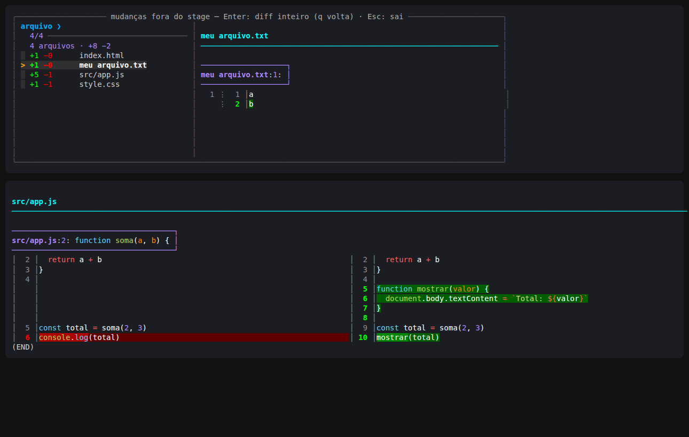
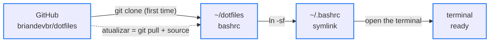

<div align="center">

# 🐚 dotfiles

> 🌐 Leia em [Português](./README.md)

[](#-how-it-works)

[](#️-technologies-used)

`Bash · 67 custom commands · MIT`

</div>

The terminal I use every day on Pop!_OS: a `.bashrc` that replaces raw command output with short answers in Portuguese, with git and npm shortcuts, an interface for `git diff` and panels that explain every command. It lives in a repository so any improvement reaches the terminal with a single command: `atualizar` ("update").

---

## 📑 Table of Contents

- [🗂️ Project Structure](#️-project-structure)
- [🗂️ Project Structure - tree](#️-project-structure---tree)
- [🖼️ Preview](#️-preview)
- [💻 Usage](#-usage)
- [🔄 How it works](#-how-it-works)
- [⚙️ Technologies used](#️-technologies-used)
- [🚀 How to run](#-how-to-run)
- [✨ Features](#-features)
- [🤝 Contributing](#-contributing)
- [📄 License](#-license)

---

## 🗂️ Project Structure

| Path | Description |
|---|---|
| `bashrc` | The whole terminal (~2,300 lines, commented in Portuguese): prompt, color palette, git and npm shortcuts, `dev` and `help` panels, the `gd` interface and the `atualizar` command. It becomes `~/.bashrc` through a symlink |
| `LICENSE` | MIT license: anyone can use, copy and modify it, as long as the copyright notice is kept |
| `docs/gd.png` | Real screenshot of the `gd` interface: the file list with the diff preview and, below, the full-screen side-by-side diff |
| `README.md` | This documentation, in Portuguese |
| `README.en.md` | The same documentation, in English |

---

## 🗂️ Project Structure - tree

```
🗂️
├── 📁 docs
│  └── 🖼️ gd.png
├── ⚙️ bashrc
├── 🗒️ LICENSE
├── 🇺🇸 README.en.md
└── 🇧🇷 README.md
```

---

## 🖼️ Preview



<sub>Top: `gd` — changed files with added (+) and removed (−) lines, preview on the right. Bottom: Enter opens the whole file, side by side when the screen is wide.</sub>

---

## 💻 Usage

Everything custom shows up in `dev`, with the original command under each shortcut. Native system commands live in `help` (over 100, in 14 sections), and `help diff` opens a full guide to `git diff`. The interface text is in Portuguese.

Before a merge, `gin` shows what is about to come into the current branch:

```text
$ gin feature/cardapio
  ⇉  3 commits entram na main  vindo de feature/cardapio · 2 arquivos · +3 −0
     794e1b1 fix: corrige texto do a.txt
     6a5da03 feat: adiciona pizza de calabresa
     148ef7c feat: cria página do cardápio
     ↳ ver o código que vem: git diff HEAD...feature/cardapio  ·  trazer: gm feature/cardapio
```

`npkg` creates a ready-to-use `package.json`, named after the folder:

```text
$ npkg
  ✓  package.json criado   pizzaria-3-irmaos
     tipo      módulos com import/export  ("type": "module")
     scripts   ns → node index.js · nrd → recarrega sozinho · nt → testes
     ↳ falta o index.js: touch index.js  — depois é só nrd
```

A mistyped command turns into a suggestion:

```text
$ gti status
  ✗  gti: comando não encontrado
     ↳ quis dizer git status?
```

And `atualizar` brings in the new version from the repository without opening another terminal:

```text
$ atualizar
  ⟳  terminal atualizado   1 mudança · 47ms
     • feat: adiciona comando oi
     ↳ deu ruim? volta pra anterior: git -C ~/dotfiles reset --hard 65a02fa && source ~/.bashrc
```

---

## 🔄 How it works



<sub>Blue border = done</sub>

`~/.bashrc` is not a copy: it is a symlink to the repository's `bashrc`. That's why `atualizar` only needs a `git pull` and a `source ~/.bashrc` to bring the open terminal to the new version. Before that, it checks you haven't edited the file yourself, so nothing gets lost.

An example of the kind of detail the file takes care of, `open`:

```text
Command:   open   (open the current folder in the file manager)
Naive:     alias open='xdg-open .'
           → terminal stuck + "** Message: Connecting to org.freedesktop.Tracker3..."   ❌
_abrir:    setsid -f xdg-open . </dev/null >/dev/null 2>&1
           → the app opens on its own and the terminal is free right away              ✅
```

---

## ⚙️ Technologies used

- [Bash](https://www.gnu.org/software/bash/) — the shell; everything is a function or alias inside `bashrc`
- [Git](https://git-scm.com/) — behind the 28 git shortcuts and `atualizar`
- [fzf](https://github.com/junegunn/fzf) — the searchable lists with preview (`gd`, `gds`, `gin`, `ga`, `gco`, `proj`, `ff`)
- [delta](https://github.com/dandavison/delta) — `git diff` with syntax colors and line numbers
- [zoxide](https://github.com/ajeetdsouza/zoxide) — a `cd` that remembers visited folders
- [eza](https://github.com/eza-community/eza) — `ls` with icons and git status
- [bat](https://github.com/sharkdp/bat) — `cat` with syntax highlighting
- [fd](https://github.com/sharkdp/fd) — the file search that feeds fzf
- [nvm](https://github.com/nvm-sh/nvm) — Node, loaded only when a node command is used (faster terminal startup)
- [cosmic-randr](https://github.com/pop-os/cosmic-randr) — `tela on/off` (laptop screen) on the COSMIC desktop of [Pop!_OS](https://pop.system76.com/)

Every tool except Bash and Git is optional: `bashrc` checks whether each one is installed before using it.

---

## 🚀 How to run

Prerequisite: Linux with Bash and Git (built and used on Pop!_OS 24.04). To get everything, install the optional tools:

```bash
sudo apt install fzf zoxide eza bat fd-find git-delta
```

Install:

```bash
git clone https://github.com/briandevbr/dotfiles.git ~/dotfiles
cp ~/.bashrc ~/.bashrc.antes-dotfiles     # keeps the old .bashrc
ln -sf ~/dotfiles/bashrc ~/.bashrc        # ~/.bashrc becomes a symlink to the repo's file
source ~/.bashrc
```

When the terminal opens you get the `◈  GROUND CONTROL` banner with the date and the two-line prompt:

```text
[brian] in 08:48:12  ~/Documents/projetos/Pizzaria3Irmaos main
$
```

To use another name, change `[brian]` in the `PS1` line. The projects folder, the `timebox` length and the repository folder are in the **CONFIGURAÇÃO** block at the top of `bashrc`.

---

## ✨ Features

- [x] Two-line prompt: time, folder, branch and the error code when the last command fails
- [x] 28 git shortcuts with a summary in Portuguese; on errors, the error is formatted with a hint on what to do
- [x] `gd`/`gds` interface: file list with preview and full-screen diff, side by side when it fits
- [x] `gin`: the commits that will come in before a merge
- [x] npm shortcuts that only run inside a project, plus `npkg` to create `package.json`
- [x] `dev` (with the original command for each shortcut) and `help` panels, plus the `help diff` guide
- [x] Suggestion for mistyped commands and the apt package for commands that don't exist
- [x] `open` and `diario` without locking the terminal
- [x] `clean`, `bkp`, `port`, `serve`, `timebox`, `status` and `tela`
- [x] `atualizar`: downloads the new version and reloads right away

---

## 🤝 Contributing

Personal project — no external contribution process for now. Suggestions are welcome via [issues](https://github.com/briandevbr/dotfiles/issues).

---

## 📄 License

This project is under the [MIT](./LICENSE) license.

---

<div align="center">
  <sub>Made by <a href="https://github.com/briandevbr">David Brian</a> · the terminal I use every day on Pop!_OS</sub>
</div>
