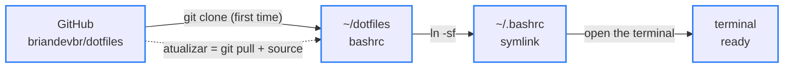

<div align="center">

# 🐚 dotfiles

> 🌐 Leia em [Português](./README.md)

[](#-how-it-works)

[](#️-technologies-used)

`Bash · 67 custom commands · MIT`

</div>

The terminal I use every day on Pop!_OS: a `.bashrc` that replaces raw command output with short answers in Portuguese, with git and npm shortcuts, an interface for `git diff` and panels that explain every command. It lives in a repository so any improvement reaches the terminal with a single command: `atualizar` ("update").

---

## 📑 Table of Contents

- [🗂️ Project Structure](#️-project-structure)
- [🗂️ Project Structure - tree](#️-project-structure---tree)
- [🖼️ Preview](#️-preview)
- [💻 Usage](#-usage)
- [🔄 How it works](#-how-it-works)
- [⚙️ Technologies used](#️-technologies-used)
- [🚀 How to run](#-how-to-run)
- [🌍 For everyone](#-for-everyone)
- [📄 License](#-license)

---

## 🗂️ Project Structure

| Path | Description |
|---|---|
| `bashrc` | The whole terminal (~2,300 lines, commented in Portuguese): prompt, color palette, git and npm shortcuts, `dev` and `help` panels, the `gd` interface and the `atualizar` command. It becomes `~/.bashrc` through a symlink |
| `LICENSE` | MIT license: anyone can use, copy and modify it, as long as the copyright notice is kept |
| `docs/gd.png` | Real screenshot of the `gd` interface: the file list with the diff preview and, below, the full-screen side-by-side diff |
| `README.md` | This documentation, in Portuguese |
| `README.en.md` | The same documentation, in English |

---

## 🗂️ Project Structure - tree

```
🗂️
├── 📁 docs
│  └── 🖼️ gd.png
├── ⚙️ bashrc
├── 🗒️ LICENSE
├── 🇺🇸 README.en.md
└── 🇧🇷 README.md
```

---

## 🖼️ Preview


<sub>Top: `gd` — changed files with added (+) and removed (−) lines, preview on the right. Bottom: Enter opens the whole file, side by side when the screen is wide.</sub>

---

## 💻 Usage

In a regular terminal you have to memorize long commands, and the answers come in dense technical English. Sometimes there's no answer at all, and you're left wondering whether it worked. Here every command answers in one line, in Portuguese, saying what happened and what to do next.

### Why it beats the default terminal

- **Interface** — answers use the same colors as the prompt: green ✓ when it worked, red ✗ when it didn't, with a hint on how to fix it right below. The prompt shows the time, the folder, the git branch and warns you when the last command failed. In several commands, if you don't type a file or branch name, a searchable list with preview opens so you can pick one.
- **Productivity** — short shortcuts do the work of long commands: `gac "message"` does the same as `git add --all && git commit -m "message"`. Swapped letters by accident, like `gti`? It suggests the right command. And `atualizar` brings the terminal to its newest version with a single word.
- **Performance** — the terminal opens fast because it only loads what you use: Node, for example, is only turned on the first time you run one of its commands. Tools faster than the defaults kick in on their own if they're installed: `fd` for file searches and `rg` instead of `grep` inside `ff`. And `open` opens the folder without locking the terminal.

### Forgot a command? Use `dev` and `help`

| Command | What it shows |
|---|---|
| `dev` | Every command in this terminal, grouped by topic, with what each one does and the original command it runs underneath. That way you learn real git while using the shortcuts |
| `help` | Over 100 commands that already come with Linux, explained in Portuguese and split into 14 topics (`help rede` shows just one of them) |
| `help diff` | A full guide to `git diff`, from what it does to how to read its output |

### In practice (the terminal speaks Portuguese)

Typo? It understands what you meant:

```text
$ gti status
  ✗  gti: comando não encontrado
     ↳ quis dizer git status?
```

Before bringing another branch's work into yours, see what's coming:

```text
$ gin feature/cardapio
  ⇉  3 commits entram na main  vindo de feature/cardapio · 2 arquivos · +3 −0
     794e1b1 fix: corrige texto do a.txt
     6a5da03 feat: adiciona pizza de calabresa
     148ef7c feat: cria página do cardápio
     ↳ ver o código que vem: git diff HEAD...feature/cardapio  ·  trazer: gm feature/cardapio
```

New improvements arrive with one command, no need to open another terminal:

```text
$ atualizar
  ⟳  terminal atualizado   1 mudança · 47ms
     • feat: adiciona comando oi
     ↳ deu ruim? volta pra anterior: git -C ~/dotfiles reset --hard 65a02fa && source ~/.bashrc
```

---

## 🔄 How it works



<sub>Blue border = done</sub>

`~/.bashrc` is not a copy: it is a symlink to the repository's `bashrc`. That's why `atualizar` only needs a `git pull` and a `source ~/.bashrc` to bring the open terminal to the new version. Before that, it checks you haven't edited the file yourself, so nothing gets lost.

An example of the kind of detail the file takes care of, `open`:

```text
Command:   open   (open the current folder in the file manager)
Naive:     alias open='xdg-open .'
           → terminal stuck + "** Message: Connecting to org.freedesktop.Tracker3..."   ❌
_abrir:    setsid -f xdg-open . </dev/null >/dev/null 2>&1
           → the app opens on its own and the terminal is free right away              ✅
```

---

## ⚙️ Technologies used

- [Bash](https://www.gnu.org/software/bash/) — the shell; everything is a function or alias inside `bashrc`
- [Git](https://git-scm.com/) — behind the 28 git shortcuts and `atualizar`
- [fzf](https://github.com/junegunn/fzf) — the searchable lists with preview (`gd`, `gds`, `gin`, `ga`, `gco`, `proj`, `ff`)
- [delta](https://github.com/dandavison/delta) — `git diff` with syntax colors and line numbers
- [zoxide](https://github.com/ajeetdsouza/zoxide) — a `cd` that remembers visited folders
- [eza](https://github.com/eza-community/eza) — `ls` with icons and git status
- [bat](https://github.com/sharkdp/bat) — `cat` with syntax highlighting
- [fd](https://github.com/sharkdp/fd) — the file search that feeds fzf
- [nvm](https://github.com/nvm-sh/nvm) — Node, loaded only when a node command is used (faster terminal startup)
- [cosmic-randr](https://github.com/pop-os/cosmic-randr) — `tela on/off` (laptop screen) on the COSMIC desktop of [Pop!_OS](https://pop.system76.com/)

Every tool except Bash and Git is optional: `bashrc` checks whether each one is installed before using it.

---

## 🚀 How to run

Prerequisite: Linux with Bash and Git (built and used on Pop!_OS 24.04). To get everything, install the optional tools:

```bash
sudo apt install fzf zoxide eza bat fd-find git-delta
```

Install:

```bash
git clone https://github.com/briandevbr/dotfiles.git ~/dotfiles
cp ~/.bashrc ~/.bashrc.antes-dotfiles     # keeps the old .bashrc
ln -sf ~/dotfiles/bashrc ~/.bashrc        # ~/.bashrc becomes a symlink to the repo's file
source ~/.bashrc
```

When the terminal opens you get the `◈  GROUND CONTROL` banner with the date and the two-line prompt:

```text
[brian] in 08:48:12  ~/Documents/projetos/Pizzaria3Irmaos main
$
```

To use another name, change `[brian]` in the `PS1` line. The projects folder, the `timebox` length and the repository folder are in the **CONFIGURAÇÃO** block at the top of `bashrc`.

---

## 🌍 For everyone

This terminal is open to anyone: you can install it, use it and adapt it your way, no permission needed (MIT license). Follow [How to run](#-how-to-run), swap the `[brian]` in the prompt for your name and you're done. Found a problem or have an idea? Open an [issue](https://github.com/briandevbr/dotfiles/issues).

---

## 📄 License

This project is under the [MIT](./LICENSE) license.

---

<div align="center">
  <sub>Made by <a href="https://github.com/briandevbr">David Brian</a> · the most accessible terminal possible, made for you</sub>
</div>
