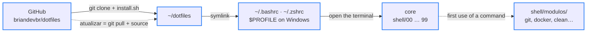

<div align="center">

# 🐚 dotfiles

> 🌐 Leia em [Português](./README.md)

[](#-how-it-works)

[](#️-technologies-used)

`Bash · Zsh · PowerShell · 131 commands · MIT`

</div>

The terminal I use every day on Pop!_OS, now also on zsh (Linux and macOS) and PowerShell (Windows): it replaces raw command output with short answers in Portuguese, with git, npm and docker shortcuts, an interface for `git diff`, panels that explain every command and safe power and system-cleanup controls. It lives in a repository so any improvement reaches the terminal with a single command: `atualizar` ("update").

---

## 📑 Table of Contents

- [🗂️ Project Structure](#️-project-structure)
- [🗂️ Project Structure - tree](#️-project-structure---tree)
- [🖼️ Preview](#️-preview)
- [💻 Usage](#-usage)
- [🔄 How it works](#-how-it-works)
- [🧪 Tests](#-tests)
- [⚙️ Technologies used](#️-technologies-used)
- [🚀 How to run](#-how-to-run)
- [✨ Features](#-features)
- [🌍 For everyone](#-for-everyone)
- [📄 License](#-license)

---

## 🗂️ Project Structure

| Path | Description |
|---|---|
| `bashrc` | The bash entry point: `~/.bashrc` is a symlink to it. It finds the repository by following the symlink and loads the files in `shell/` in numeric order. `DOTFILES_PERFIL=1 bash` shows how long each one took |
| `zshrc` | The zsh entry point (Linux and macOS): it loads the **same** files from `shell/` in ksh emulation, so a single codebase serves both shells |
| `install.sh` | Installer for Linux, macOS and WSL: links `~/.bashrc` and `~/.zshrc` to the repository, keeping the old ones with the date in the name, creates `local.sh` and, with `--ferramentas`, installs fzf, zoxide, eza, bat, fd, ripgrep, delta and jq with the system's package manager |
| `shell/00-plataforma.sh` | Detects where it's running (Linux, macOS, WSL, distro, apt/pacman/dnf/brew) and hides the GNU vs BSD differences: `_humano` instead of `numfmt`, `_livre_bytes`, `_abrir`, `_notificar`, caching of the tools' `init` output |
| `shell/10-config.sh` | The **CONFIGURAÇÃO** (settings) block: projects folder, `timebox` length, prompt name, animations, countdown before powering off |
| `shell/20-ui.sh` | The palette and the standard answers (`_ok`, `_err`, `_aviso`…), spinner (`_rodar`), progress bar, countdown and reading the branch straight from `.git/HEAD` |
| `shell/30-ferramentas.sh` | Turns on fzf, eza, bat, fd, delta, nvm (lazy) and Homebrew — each one only if installed |
| `shell/40-modulos.sh` | On-demand loading: every command starts as a one-line stub, and its module is only read on first use |
| `shell/50-atalhos.sh` | The aliases (`..`, `p`, `rm -i`, `limpar`, old names) and the panels' sections |
| `shell/99-inicio.sh` | Opening banner (animated on the first terminal of the day) and jumping into the projects folder |
| `shell/bash/` | Bash-only parts: history, `shopt`, bash-completion, keys, prompt with `PROMPT_COMMAND`/`PS0` and Tab for the shortcuts |
| `shell/zsh/interativo.zsh` | Zsh-only parts: history, case-insensitive Tab (compiled compinit), arrow keys, zoxide, fzf and the same prompt as bash |
| `shell/modulos/git.sh` | The 34 git shortcuts (`gs`, `gac`, `gcm`, `gp`, `gup`, `gpr`…) and the `gd`/`gds` interface |
| `shell/modulos/navegacao.sh` | `open`, `mkcd`, `up`, `cdr`, `proj`, `extract`, `compactar`, `bak`, `lixo`, `espaco`, `cpv`, `ff` |
| `shell/modulos/sistema.sh` | `clean` (deep cleanup with a report), `upgrade`, `rmpkg`, `rmapp`, `bkp`, `timebox`, `atualizar`, `tela` |
| `shell/modulos/energia.sh` | `poweroff`, `reboot` and `suspend` with checks, a preventive log and a countdown |
| `shell/modulos/rede.sh` | `port`, `portas`, `serve`, `waitport`, `httpcheck`, `meuip`, `rede`, `psg`, `pk`, `topcpu`, `topmem`, `mon` |
| `shell/modulos/docker.sh` | `dps`, `dlog`, `dsh`, `dstop`, `drm`, `dclean`, `dstats` and compose (`dc`, `dcu`, `dcd`, `dcl`, `dcr`) |
| `shell/modulos/node.sh` | `ni`, `nr`, `nrd`, `nrb`, `ns`, `nt`, `nid`, `nfresh`, `nout`, `npkg` — they use pnpm/yarn/bun when the project has their lockfile |
| `shell/modulos/utilitarios.sh` | `clip`, `colar`, `json`, `uuid`, `senha`, `b64`, `epoch`, `calc`, `loadenv`, `venv`, `mkscript`, `cheat` |
| `shell/modulos/paineis.sh` | The `status`, `dev` and `help` panels, the `help diff` guide and the `dotfiles` check-up |
| `shell/modulos/erros.sh` | The "command not found" that suggests the right one (`gti` → `git`) or the package that installs it |
| `windows/Microsoft.PowerShell_profile.ps1` | The same terminal on PowerShell 5.1 and 7+: same prompt, colors and shortcuts. A single file, ready to copy and paste (UTF-8 with BOM, otherwise 5.1 garbles the accents) |
| `windows/install.ps1` | Makes both PowerShells' `$PROFILE` load the repository's file and, with `-Ferramentas`, installs fzf, zoxide, ripgrep, delta and jq with winget |
| `windows/PSScriptAnalyzerSettings.psd1` | PSScriptAnalyzer rules for the profile (style rules are left out: here the short shortcuts are the point) |
| `tests/rodar.sh` | Runs the suite on bash and zsh, each in a throwaway HOME |
| `tests/casos.sh` | The bash/zsh test cases (helpers, git with a local remote, ports with a real server, power, clean, atualizar…) |
| `tests/casos.ps1` | The PowerShell profile test cases |
| `tests/stubs/` | Fake `sudo`, `systemctl`, `shutdown`, `apt`, `docker`…: they only log the call, so nothing powers off or gets installed during tests |
| `.github/workflows/testes.yml` | CI on every push: lint, Linux (with and without the optional tools), macOS and Windows |
| `.shellcheckrc` | ShellCheck settings for the modules |
| `docs/gd.png` | Real screenshot of the `gd` interface: the file list with the diff preview and, below, the full-screen side-by-side diff |
| `LICENSE` | MIT license: anyone can use, copy and modify it, as long as the copyright notice is kept |
| `README.md` | The documentation, in Portuguese |
| `README.en.md` | This documentation, in English |

---

## 🗂️ Project Structure - tree

```
🗂️
├── 📁 .github
│  └── 📁 workflows
│     └── 🔧 testes.yml
├── 📁 docs
│  └── 🖼️ gd.png
├── 📁 shell
│  ├── 📁 bash
│  │  ├── ⚙️ base.sh
│  │  └── ⚙️ interativo.sh
│  ├── 📁 modulos
│  │  └── … (10 modules: docker, energia, erros, git, navegacao, node, paineis, rede, sistema, utilitarios)
│  ├── 📁 zsh
│  │  └── ⚙️ interativo.zsh
│  ├── ⚙️ 00-plataforma.sh
│  ├── 🔧 10-config.sh
│  ├── ⚙️ 20-ui.sh
│  ├── ⚙️ 30-ferramentas.sh
│  ├── ⚙️ 40-modulos.sh
│  ├── ⚙️ 50-atalhos.sh
│  └── ⚙️ 99-inicio.sh
├── 📁 tests
│  ├── 📁 stubs
│  │  └── … (20 fake commands)
│  ├── 🧪 casos.ps1
│  ├── 🧪 casos.sh
│  └── 🧪 rodar.sh
├── 📁 windows
│  ├── ⚙️ install.ps1
│  ├── ⚙️ Microsoft.PowerShell_profile.ps1
│  └── 🔧 PSScriptAnalyzerSettings.psd1
├── 🔧 .shellcheckrc
├── ⚙️ bashrc
├── ⚙️ install.sh
├── 🗒️ LICENSE
├── 🇺🇸 README.en.md
├── 🇧🇷 README.md
└── ⚙️ zshrc
```

---

## 🖼️ Preview


<sub>Top: `gd` — changed files with added (+) and removed (−) lines, preview on the right. Bottom: Enter opens the whole file, side by side when the screen is wide.</sub>

---

## 💻 Usage

In a regular terminal you have to memorize long commands, and the answers come in dense technical English. Sometimes there's no answer at all, and you're left wondering whether it worked. Here every command answers in one line, in Portuguese, saying what happened and what to do next.

### Why it beats the default terminal

- **Interface** — answers use the same colors as the prompt: green ✓ when it worked, red ✗ when it didn't, with a hint on how to fix it right below. Slow operations show a spinner with a running timer; cleanup and upgrades show a progress bar per step. The prompt shows the time, the folder, the git branch, warns you when the last command failed and how long a slow command took (`⏱ 12s`). In several commands, if you don't type a file, branch or container name, a searchable list with preview opens.
- **Productivity** — short shortcuts do the work of long commands: `gac "message"` does the same as `git add --all && git commit -m "message"`, and `gcm feat:login adds button` builds the commit in the Conventional Commits format (on its own, `gcm` shows each type, when to use it and an example). Swapped letters by accident, like `gti`? It suggests the right command. And `atualizar` brings the terminal to its newest version with a single word.
- **Performance** — the terminal opens in ~21ms on bash and ~14ms on zsh (the old `bashrc` took ~29ms, with half the commands). Commands are only read the first time you use one of them, the prompt reads the branch without starting git, and the tools don't run on every terminal: their `init` output is cached.
- **Safety** — `poweroff`, `reboot` and `suspend` first check what could be lost (running programs, projects with changes outside git, an installation in progress), ask, save a log and still give you a 5-second countdown that Ctrl+C cancels. `clean -n` shows how much can be freed without deleting anything.

### Forgot a command? Use `dev` and `help`

| Command | What it shows |
|---|---|
| `dev` | Every command in this terminal, grouped into 13 topics, with what each one does and the original command it runs underneath. That way you learn real git while using the shortcuts (`dev git` shows just one topic) |
| `help` | Over 100 commands that already come with Linux, explained in Portuguese and split into 14 topics (`help rede` shows just one of them) |
| `help diff` | A full guide to `git diff`, from what it does to how to read its output |
| `dotfiles` | Terminal check-up: what's installed, what's missing and the command that installs it on your system. `dotfiles tempo` measures how long it takes to open |

### In practice (the terminal speaks Portuguese)

Typo? It understands what you meant:

```text
$ gti status
  ✗  gti: comando não encontrado
     ↳ quis dizer git status?
```

Before bringing another branch's work into yours, see what's coming:

```text
$ gin feature/cardapio
  ⇉  3 commits entram na main  vindo de feature/cardapio · 2 arquivos · +3 −0
     794e1b1 fix: corrige texto do a.txt
     6a5da03 feat: adiciona pizza de calabresa
     148ef7c feat: cria página do cardápio
     ↳ ver o código que vem: git diff HEAD...feature/cardapio  ·  trazer: gm feature/cardapio
```

A Conventional Commits commit without memorizing the format (with no arguments, it opens the list of types):

```text
$ gcm feat:login adiciona botão de entrar
  ◆  commit criado
     branch    main
     hash      0b9eee2
     arquivos  1   +1 −0
     mensagem  feat(login): adiciona botão de entrar
```

Powering off checks what could be lost first:

```text
$ poweroff
  ⏻  desligar o computador  ligado há 1h12
  !  1 projeto com mudanças fora do git
     ↳ loja
  ?  pode desligar? [s/N]
```

New improvements arrive with one command, no need to open another terminal:

```text
$ atualizar
  ⟳  terminal atualizado   1 mudança · 47ms
     • feat: adiciona comando oi
     ↳ deu ruim? volta pra anterior: git -C ~/dotfiles reset --hard 65a02fa && source ~/.bashrc
```

---

## 🔄 How it works



<sub>Blue border = done · dashed arrow = happens later, only when needed</sub>

`~/.bashrc` (and `~/.zshrc`) is not a copy: it's a symlink to the repository's file. That's why `atualizar` only needs a `git pull` and a `source` to bring the open terminal to the new version. Before that, it checks you haven't edited the files yourself, so nothing gets lost — personal tweaks go in `~/.config/dotfiles/local.sh`, outside the repository.

What makes the terminal open fast even with 131 commands is on-demand loading:

```text
Command:   gs   (the first time in this terminal)
Before:    bash read all 2,300 lines on every terminal, used or not             ❌
Now:       gs() { _df_sob_demanda git gs "$@"; }
           → only now reads shell/modulos/git.sh, swaps the stub for the function and runs it  ✅
```

The list of stubs builds itself by reading the modules and is cached — a new function in a module shows up in the next terminal. The same care goes into `open`, which already existed:

```text
Naive:     alias open='xdg-open .'
           → terminal stuck + "** Message: Connecting to org.freedesktop.Tracker3..."   ❌
_abrir:    setsid -f xdg-open . </dev/null >/dev/null 2>&1   (macOS: open · WSL: explorer.exe)
           → the app opens on its own and the terminal is free right away              ✅
```

---

## 🧪 Tests

```bash
tests/rodar.sh          # bash and zsh
tests/rodar.sh zsh      # just one
pwsh -NoProfile -File tests/casos.ps1     # PowerShell (on Windows: powershell -File tests\casos.ps1)
```

| Suite | Cases | What it covers |
|---|---|---|
| bash | 255 | helpers, spinner, on-demand loading, navigation and files (compactar → extract round trip), utilities, the whole git flow with a local remote, node, ports with a real HTTP server, docker stopped, `clean`/`upgrade`, power, panels, prompt and `atualizar` with a fake repository |
| zsh | 254 | the same cases (except `help cd`, which is bash-only) |
| PowerShell | 85 | the Windows profile: helpers, files, git, node, power, panels |

Each shell runs in a throwaway HOME and the dangerous commands (`sudo`, `systemctl`, `shutdown`, `apt`…) are stubs that only log the call: the tests never power off or install anything. On [GitHub Actions](https://docs.github.com/actions) the suite runs on every push on Linux (with and without the optional tools), macOS (zsh and bash 5) and Windows (PowerShell 5.1 and 7), along with [ShellCheck](https://www.shellcheck.net/) and [PSScriptAnalyzer](https://github.com/PowerShell/PSScriptAnalyzer).

---

## ⚙️ Technologies used

- [Bash](https://www.gnu.org/software/bash/) — the main shell; everything is a function or alias inside `shell/`
- [Zsh](https://www.zsh.org/) — runs the same modules in ksh emulation (Linux and macOS)
- [PowerShell](https://learn.microsoft.com/powershell/) — the Windows profile (5.1 and 7+)
- [Git](https://git-scm.com/) — behind the 34 git shortcuts and `atualizar`
- [fzf](https://github.com/junegunn/fzf) — the searchable lists with preview (`gd`, `gds`, `gin`, `ga`, `gco`, `gbr`, `proj`, `ff`, `pk`, `dlog`…)
- [delta](https://github.com/dandavison/delta) — `git diff` with syntax colors and line numbers
- [zoxide](https://github.com/ajeetdsouza/zoxide) — a `cd` that remembers visited folders
- [eza](https://github.com/eza-community/eza) — `ls` with icons and git status
- [bat](https://github.com/sharkdp/bat) — `cat` with syntax highlighting
- [fd](https://github.com/sharkdp/fd) — the file search that feeds fzf and `ff`
- [ripgrep](https://github.com/BurntSushi/ripgrep) — the text search in `ff text`
- [jq](https://jqlang.github.io/jq/) — pretty `json` output
- [Docker](https://docs.docker.com/) — the `d*` shortcuts and compose
- [nvm](https://github.com/nvm-sh/nvm) — Node, loaded only when a node command is used
- [Homebrew](https://brew.sh/) and [winget](https://learn.microsoft.com/windows/package-manager/winget/) — installing the tools on macOS and Windows
- [cosmic-randr](https://github.com/pop-os/cosmic-randr) — `tela on/off` (laptop screen) on the COSMIC desktop of [Pop!_OS](https://pop.system76.com/)
- [ShellCheck](https://www.shellcheck.net/), [PSScriptAnalyzer](https://github.com/PowerShell/PSScriptAnalyzer) and [GitHub Actions](https://docs.github.com/actions) — validation on every push

Every tool except the shell and Git is optional: each command checks whether what it needs is installed and, if not, tells you the command that installs it on your system (`apt`, `pacman`, `dnf` or `brew`).

---

## 🚀 How to run

Prerequisite: Git. The installer takes care of the rest.

### Linux (Debian, Ubuntu, Pop!_OS, Arch, Fedora) — bash or zsh

```bash
git clone https://github.com/briandevbr/dotfiles.git ~/dotfiles
~/dotfiles/install.sh --ferramentas     # without --ferramentas it only links the terminal
```

### macOS — zsh (Homebrew)

```bash
git clone https://github.com/briandevbr/dotfiles.git ~/dotfiles
~/dotfiles/install.sh --ferramentas     # installs the tools with brew
```

The bash that ships with macOS is 3.2, too old: use zsh (already the default) or `brew install bash`.

### Windows — PowerShell

Open **PowerShell** from the Start menu (not Command Prompt: there `$HOME` doesn't work and the clone ends up in the wrong folder). It doesn't need to be as administrator. Run **one command at a time**: `winget` may stop to ask whether you accept its terms (answer `Y`).

```powershell
winget install Git.Git
git clone https://github.com/briandevbr/dotfiles.git $HOME\dotfiles
powershell -ExecutionPolicy Bypass -File $HOME\dotfiles\windows\install.ps1 -Ferramentas
```

Rather copy and paste? Open the profile with `notepad $PROFILE`, paste the contents of `windows/Microsoft.PowerShell_profile.ps1` and save it as **UTF-8 with BOM** (without the BOM, PowerShell 5.1 shows the accents garbled). Use [Windows Terminal](https://learn.microsoft.com/windows/terminal/) so the colors show up. On PowerShell 7.3+ `clean` became a reserved word, so there the cleanup is `limpar`.

### WSL

Follow the Linux steps inside the distro. `open`, `clip`, notifications and `poweroff` talk to Windows (`poweroff` shuts down the whole Windows, and says so first).

When the terminal opens you get the `◈  GROUND CONTROL` banner with the date and how long it took to open, and the two-line prompt:

```text
[brian] in 08:48:12  ~/Documents/projetos/Pizzaria3Irmaos main
$
```

To use another name, projects folder or `timebox` length, put it in `~/.config/dotfiles/local.sh` (the installer creates it with examples): `PROMPT_NOME="ana"`. That file lives outside the repository, so `atualizar` never touches it.

---

## ✨ Features

- [x] Prompt with time, folder, branch (read without starting git), error and slow-command time
- [x] The 68 original commands preserved — 131 in total
- [x] On-demand loading: bash opens in ~21ms (before ~29ms) and zsh in ~14ms
- [x] Visual feedback: ✓/✗ with hints, spinner, progress bar and an animated banner on the first terminal of the day
- [x] `poweroff`, `reboot` and `suspend` with checks, preventive log, countdown and scheduling
- [x] Deep `clean` (apt, pacman, dnf, flatpak, snap, brew, npm, pip, logs and temp files) with a report and dry run; `upgrade`
- [x] Git with Conventional Commits (`gcm`), PR in the browser (`gpr`), `gup`, `gbr`, `gwip`
- [x] Docker, network, process and dev utilities
- [x] Zsh on Linux and macOS with the same code, PowerShell 5.1/7 on Windows, and WSL
- [x] Installers you can run as many times as you like
- [x] 594 tests on bash, zsh and PowerShell, running in CI on Linux, macOS and Windows

---

## 🌍 For everyone

This terminal is open to anyone: you can install it, use it and adapt it your way, no permission needed (MIT license). Follow [How to run](#-how-to-run), put your name in `PROMPT_NOME` inside `local.sh` and you're done. Found a problem or have an idea? Open an [issue](https://github.com/briandevbr/dotfiles/issues).

---

## 📄 License

This project is under the [MIT](./LICENSE) license.

---

<div align="center">
  <sub>Made by <a href="https://github.com/briandevbr">David Brian</a> · the most accessible terminal possible, made for you</sub>
</div>
