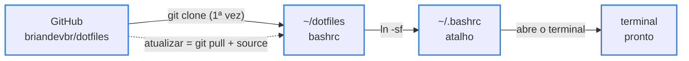

<div align="center">

# 🐚 dotfiles

> 🌐 Read this in [English](./README.en.md)

[](#-como-funciona)

[](#️-tecnologias-usadas)

`Bash · 67 comandos personalizados · MIT`

</div>

O terminal que eu uso todo dia no Pop!_OS: um `.bashrc` que troca a saída crua dos comandos por respostas curtas em português, com atalhos de git e npm, uma interface pro `git diff` e painéis que explicam cada comando. Fica num repositório pra que qualquer melhoria chegue no terminal com um único comando: `atualizar`.

---

## 📑 Sumário

- [🗂️ Estrutura do Projeto](#️-estrutura-do-projeto)
- [🗂️ Estrutura do Projeto - tree](#️-estrutura-do-projeto---tree)
- [🖼️ Prévia](#️-prévia)
- [💻 Uso](#-uso)
- [🔄 Como funciona](#-como-funciona)
- [⚙️ Tecnologias usadas](#️-tecnologias-usadas)
- [🚀 Como rodar](#-como-rodar)
- [✨ Funcionalidades](#-funcionalidades)
- [🤝 Contribuindo](#-contribuindo)
- [📄 Licença](#-licença)

---

## 🗂️ Estrutura do Projeto

| Caminho | Descrição |
|---|---|
| `bashrc` | O terminal inteiro (~2.300 linhas, comentadas em português): prompt, paleta de cores, atalhos de git e npm, painéis `dev` e `help`, interface do `gd` e o comando `atualizar`. Vira o `~/.bashrc` por um atalho (symlink) |
| `LICENSE` | Licença MIT: qualquer pessoa pode usar, copiar e modificar, desde que mantenha o aviso de copyright |
| `docs/gd.png` | Captura real da interface do `gd`: a lista de arquivos com a prévia do diff e, embaixo, o diff em tela cheia lado a lado |
| `README.md` | Esta documentação, em português |
| `README.en.md` | A mesma documentação, em inglês |

---

## 🗂️ Estrutura do Projeto - tree

```
🗂️
├── 📁 docs
│  └── 🖼️ gd.png
├── ⚙️ bashrc
├── 🗒️ LICENSE
├── 🇺🇸 README.en.md
└── 🇧🇷 README.md
```

---

## 🖼️ Prévia


<sub>Em cima, o `gd`: arquivos mudados com linhas que entraram (+) e saíram (−) e a prévia à direita. Embaixo, o Enter abre o arquivo inteiro, lado a lado quando a tela é larga.</sub>

---

## 💻 Uso

Tudo que é personalizado aparece no `dev`, com o comando original embaixo de cada atalho. Os nativos do sistema ficam no `help` (mais de 100, em 14 seções), e `help diff` abre um guia completo do `git diff`.

Antes de um merge, o `gin` mostra o que vai entrar na branch atual:

```text
$ gin feature/cardapio
  ⇉  3 commits entram na main  vindo de feature/cardapio · 2 arquivos · +3 −0
     794e1b1 fix: corrige texto do a.txt
     6a5da03 feat: adiciona pizza de calabresa
     148ef7c feat: cria página do cardápio
     ↳ ver o código que vem: git diff HEAD...feature/cardapio  ·  trazer: gm feature/cardapio
```

O `npkg` cria um `package.json` pronto, com o nome tirado da pasta:

```text
$ npkg
  ✓  package.json criado   pizzaria-3-irmaos
     tipo      módulos com import/export  ("type": "module")
     scripts   ns → node index.js · nrd → recarrega sozinho · nt → testes
     ↳ falta o index.js: touch index.js  — depois é só nrd
```

Comando digitado errado vira sugestão:

```text
$ gti status
  ✗  gti: comando não encontrado
     ↳ quis dizer git status?
```

E o `atualizar` traz a versão nova do repositório sem precisar abrir outro terminal:

```text
$ atualizar
  ⟳  terminal atualizado   1 mudança · 47ms
     • feat: adiciona comando oi
     ↳ deu ruim? volta pra anterior: git -C ~/dotfiles reset --hard 65a02fa && source ~/.bashrc
```

---

## 🔄 Como funciona



<sub>Borda azul = pronto</sub>

O `~/.bashrc` não é uma cópia: é um atalho pro `bashrc` do repositório. Por isso o `atualizar` só precisa de um `git pull` e de um `source ~/.bashrc` pra deixar o terminal aberto na versão nova. Antes, ele confere se você não mexeu no arquivo por conta própria, pra não perder nada.

Um exemplo do tipo de detalhe que o arquivo resolve, o `open`:

```text
Comando:   open   (abrir a pasta atual no gerenciador de arquivos)
Ingênuo:   alias open='xdg-open .'
           → terminal preso + "** Message: Connecting to org.freedesktop.Tracker3..."   ❌
_abrir:    setsid -f xdg-open . </dev/null >/dev/null 2>&1
           → o app abre separado e o terminal fica livre na hora                        ✅
```

---

## ⚙️ Tecnologias usadas

- [Bash](https://www.gnu.org/software/bash/) — o shell; tudo é função ou alias dentro do `bashrc`
- [Git](https://git-scm.com/) — base dos 28 atalhos de git e do `atualizar`
- [fzf](https://github.com/junegunn/fzf) — as listas com busca e prévia (`gd`, `gds`, `gin`, `ga`, `gco`, `proj`, `ff`)
- [delta](https://github.com/dandavison/delta) — o `git diff` com cores de código e número de linha
- [zoxide](https://github.com/ajeetdsouza/zoxide) — o `cd` que lembra das pastas visitadas
- [eza](https://github.com/eza-community/eza) — o `ls` com ícones e status do git
- [bat](https://github.com/sharkdp/bat) — o `cat` com cores de sintaxe
- [fd](https://github.com/sharkdp/fd) — a busca de arquivos que alimenta o fzf
- [nvm](https://github.com/nvm-sh/nvm) — o Node, carregado só quando um comando de node é usado (terminal abre mais rápido)
- [cosmic-randr](https://github.com/pop-os/cosmic-randr) — o `tela on/off` no desktop COSMIC do [Pop!_OS](https://pop.system76.com/)

Todas as ferramentas, menos o Bash e o Git, são opcionais: o `bashrc` confere se cada uma está instalada antes de usar.

---

## 🚀 Como rodar

Pré-requisito: Linux com Bash e Git (feito e usado no Pop!_OS 24.04). Pra ter tudo, instale as ferramentas opcionais:

```bash
sudo apt install fzf zoxide eza bat fd-find git-delta
```

Instalação:

```bash
git clone https://github.com/briandevbr/dotfiles.git ~/dotfiles
cp ~/.bashrc ~/.bashrc.antes-dotfiles     # guarda o .bashrc antigo
ln -sf ~/dotfiles/bashrc ~/.bashrc        # o ~/.bashrc vira um atalho pro do repo
source ~/.bashrc
```

Ao abrir o terminal aparece o banner `◈  GROUND CONTROL` com a data e o prompt em duas linhas:

```text
[brian] in 08:48:12  ~/Documents/projetos/Pizzaria3Irmaos main
$
```

Pra usar com outro nome, troque o `[brian]` na linha do `PS1`. A pasta de projetos, o tempo do `timebox` e a pasta do repositório ficam no bloco **CONFIGURAÇÃO**, no começo do `bashrc`.

---

## ✨ Funcionalidades

- [x] Prompt em duas linhas: hora, pasta, branch e o código do erro quando o último comando falha
- [x] 28 atalhos de git com resumo em português; quando dá erro, mostra o erro formatado e uma dica do que fazer
- [x] Interface do `gd`/`gds`: lista de arquivos com prévia e diff em tela cheia, lado a lado quando cabe
- [x] `gin`: os commits que vão entrar antes de um merge
- [x] Atalhos de npm que só rodam dentro de um projeto, e o `npkg` pra criar o `package.json`
- [x] Painéis `dev` (com o comando original de cada atalho) e `help`, mais o guia `help diff`
- [x] Sugestão pra comando digitado errado e pacote do apt pra comando que não existe
- [x] `open` e `diario` sem travar o terminal
- [x] `clean`, `bkp`, `port`, `serve`, `timebox`, `status` e `tela`
- [x] `atualizar`: baixa a versão nova e recarrega na hora

---

## 🤝 Contribuindo

Projeto pessoal — sem processo de contribuição externa no momento. Sugestões são bem-vindas via [issues](https://github.com/briandevbr/dotfiles/issues).

---

## 📄 Licença

Este projeto está sob a licença [MIT](./LICENSE).

---

<div align="center">
  <sub>Feito por <a href="https://github.com/briandevbr">David Brian</a> · o terminal que eu uso todo dia no Pop!_OS</sub>
</div>
