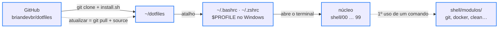

<div align="center">

# 🐚 dotfiles

> 🌐 Read this in [English](./README.en.md)

[](#-como-funciona)

[](#️-tecnologias-usadas)

`Bash · Zsh · PowerShell · 131 comandos · MIT`

</div>

O terminal que eu uso todo dia no Pop!_OS, agora também no zsh (Linux e macOS) e no PowerShell (Windows): troca a saída crua dos comandos por respostas curtas em português, com atalhos de git, npm e docker, uma interface pro `git diff`, painéis que explicam cada comando e controle seguro de energia e limpeza do sistema. Fica num repositório pra que qualquer melhoria chegue no terminal com um único comando: `atualizar`.

---

## 📑 Sumário

- [🗂️ Estrutura do Projeto](#️-estrutura-do-projeto)
- [🗂️ Estrutura do Projeto - tree](#️-estrutura-do-projeto---tree)
- [🖼️ Prévia](#️-prévia)
- [💻 Uso](#-uso)
- [🔄 Como funciona](#-como-funciona)
- [🧪 Testes](#-testes)
- [⚙️ Tecnologias usadas](#️-tecnologias-usadas)
- [🚀 Como rodar](#-como-rodar)
- [✨ Funcionalidades](#-funcionalidades)
- [🌍 Pra todo mundo usar](#-pra-todo-mundo-usar)
- [📄 Licença](#-licença)

---

## 🗂️ Estrutura do Projeto

| Caminho | Descrição |
|---|---|
| `bashrc` | Entrada do bash: o `~/.bashrc` é um atalho (symlink) pra ele. Acha o repositório seguindo o atalho e carrega os arquivos de `shell/` na ordem do número. `DOTFILES_PERFIL=1 bash` mostra quanto cada um levou |
| `zshrc` | Entrada do zsh (Linux e macOS): carrega os **mesmos** arquivos de `shell/` em emulação ksh, então um código só serve os dois shells |
| `install.sh` | Instalador do Linux, macOS e WSL: liga o `~/.bashrc` e o `~/.zshrc` ao repositório guardando os antigos com a data no nome, cria o `local.sh` e, com `--ferramentas`, instala fzf, zoxide, eza, bat, fd, ripgrep, delta e jq pelo gerenciador do sistema |
| `shell/00-plataforma.sh` | Descobre onde está rodando (Linux, macOS, WSL, distro, apt/pacman/dnf/brew) e esconde as diferenças entre GNU e BSD: `_humano` no lugar do `numfmt`, `_livre_bytes`, `_abrir`, `_notificar`, cache dos `init` das ferramentas |
| `shell/10-config.sh` | O bloco **CONFIGURAÇÃO**: pasta de projetos, tempo do `timebox`, nome do prompt, animações, contagem antes de desligar |
| `shell/20-ui.sh` | Paleta e as respostas padronizadas (`_ok`, `_err`, `_aviso`…), spinner (`_rodar`), barra de progresso, contagem regressiva e a leitura da branch direto do `.git/HEAD` |
| `shell/30-ferramentas.sh` | Liga fzf, eza, bat, fd, delta, nvm (lazy) e o Homebrew — cada um só se estiver instalado |
| `shell/40-modulos.sh` | O carregamento sob demanda: cada comando começa como uma casca de uma linha, e o módulo dele só é lido no primeiro uso |
| `shell/50-atalhos.sh` | Os aliases (`..`, `p`, `rm -i`, `limpar`, nomes antigos) e as seções dos painéis |
| `shell/99-inicio.sh` | Banner de abertura (animado no primeiro terminal do dia) e a entrada na pasta de projetos |
| `shell/bash/` | O que é só do bash: histórico, `shopt`, bash-completion, teclas, prompt com `PROMPT_COMMAND`/`PS0` e o Tab dos atalhos |
| `shell/zsh/interativo.zsh` | O que é só do zsh: histórico, Tab sem diferenciar maiúscula (compinit compilado), setas, zoxide, fzf e o mesmo prompt do bash |
| `shell/modulos/git.sh` | Os 34 atalhos de git (`gs`, `gac`, `gcm`, `gp`, `gup`, `gpr`…) e a interface do `gd`/`gds` |
| `shell/modulos/navegacao.sh` | `open`, `mkcd`, `up`, `cdr`, `proj`, `extract`, `compactar`, `bak`, `lixo`, `espaco`, `cpv`, `ff` |
| `shell/modulos/sistema.sh` | `clean` (limpeza profunda com relatório), `upgrade`, `rmpkg`, `rmapp`, `bkp`, `timebox`, `atualizar`, `tela` |
| `shell/modulos/energia.sh` | `poweroff`, `reboot` e `suspend` com checagem, log preventivo e contagem regressiva |
| `shell/modulos/rede.sh` | `port`, `portas`, `serve`, `waitport`, `httpcheck`, `meuip`, `rede`, `psg`, `pk`, `topcpu`, `topmem`, `mon` |
| `shell/modulos/docker.sh` | `dps`, `dlog`, `dsh`, `dstop`, `drm`, `dclean`, `dstats` e o compose (`dc`, `dcu`, `dcd`, `dcl`, `dcr`) |
| `shell/modulos/node.sh` | `ni`, `nr`, `nrd`, `nrb`, `ns`, `nt`, `nid`, `nfresh`, `nout`, `npkg` — usam pnpm/yarn/bun quando o projeto tem o lock deles |
| `shell/modulos/utilitarios.sh` | `clip`, `colar`, `json`, `uuid`, `senha`, `b64`, `epoch`, `calc`, `loadenv`, `venv`, `mkscript`, `cheat` |
| `shell/modulos/paineis.sh` | Os painéis `status`, `dev` e `help`, o guia `help diff` e o check-up `dotfiles` |
| `shell/modulos/erros.sh` | O "comando não encontrado" que sugere o certo (`gti` → `git`) ou o pacote que instala |
| `windows/Microsoft.PowerShell_profile.ps1` | O mesmo terminal no PowerShell 5.1 e 7+: mesmo prompt, cores e atalhos. Um arquivo só, pronto pra copiar e colar (UTF-8 com BOM, senão o 5.1 lê os acentos errado) |
| `windows/install.ps1` | Faz o `$PROFILE` dos dois PowerShells carregar o arquivo do repositório e, com `-Ferramentas`, instala fzf, zoxide, ripgrep, delta e jq pelo winget |
| `windows/PSScriptAnalyzerSettings.psd1` | Regras do PSScriptAnalyzer pro profile (as de estilo ficam de fora: aqui os atalhos curtos são o objetivo) |
| `tests/rodar.sh` | Roda a suíte no bash e no zsh, cada um num HOME descartável |
| `tests/casos.sh` | Os casos de teste do bash/zsh (helpers, git com um remoto local, portas com servidor de verdade, energia, clean, atualizar…) |
| `tests/casos.ps1` | Os casos de teste do profile do PowerShell |
| `tests/stubs/` | `sudo`, `systemctl`, `shutdown`, `apt`, `docker`… de mentira: só anotam a chamada, então nada desliga nem instala nos testes |
| `.github/workflows/testes.yml` | CI a cada push: lint, Linux (com e sem as ferramentas opcionais), macOS e Windows |
| `.shellcheckrc` | Configuração do ShellCheck pros módulos |
| `docs/gd.png` | Captura real da interface do `gd`: a lista de arquivos com a prévia do diff e, embaixo, o diff em tela cheia lado a lado |
| `LICENSE` | Licença MIT: qualquer pessoa pode usar, copiar e modificar, desde que mantenha o aviso de copyright |
| `README.md` | Esta documentação, em português |
| `README.en.md` | A mesma documentação, em inglês |

---

## 🗂️ Estrutura do Projeto - tree

```
🗂️
├── 📁 .github
│  └── 📁 workflows
│     └── 🔧 testes.yml
├── 📁 docs
│  └── 🖼️ gd.png
├── 📁 shell
│  ├── 📁 bash
│  │  ├── ⚙️ base.sh
│  │  └── ⚙️ interativo.sh
│  ├── 📁 modulos
│  │  └── … (10 módulos: docker, energia, erros, git, navegacao, node, paineis, rede, sistema, utilitarios)
│  ├── 📁 zsh
│  │  └── ⚙️ interativo.zsh
│  ├── ⚙️ 00-plataforma.sh
│  ├── 🔧 10-config.sh
│  ├── ⚙️ 20-ui.sh
│  ├── ⚙️ 30-ferramentas.sh
│  ├── ⚙️ 40-modulos.sh
│  ├── ⚙️ 50-atalhos.sh
│  └── ⚙️ 99-inicio.sh
├── 📁 tests
│  ├── 📁 stubs
│  │  └── … (20 comandos de mentira)
│  ├── 🧪 casos.ps1
│  ├── 🧪 casos.sh
│  └── 🧪 rodar.sh
├── 📁 windows
│  ├── ⚙️ install.ps1
│  ├── ⚙️ Microsoft.PowerShell_profile.ps1
│  └── 🔧 PSScriptAnalyzerSettings.psd1
├── 🔧 .shellcheckrc
├── ⚙️ bashrc
├── ⚙️ install.sh
├── 🗒️ LICENSE
├── 🇺🇸 README.en.md
├── 🇧🇷 README.md
└── ⚙️ zshrc
```

---

## 🖼️ Prévia


<sub>Em cima, o `gd`: arquivos mudados com linhas que entraram (+) e saíram (−) e a prévia à direita. Embaixo, o Enter abre o arquivo inteiro, lado a lado quando a tela é larga.</sub>

---

## 💻 Uso

Num terminal comum você precisa decorar comandos compridos, e as respostas vêm em inglês e cheias de texto técnico. Às vezes nem vem resposta, e você fica sem saber se deu certo. Aqui cada comando responde em uma linha, em português, dizendo o que aconteceu e o que fazer depois.

### Por que é melhor que o terminal padrão

- **Interface** — as respostas usam as mesmas cores do prompt: ✓ verde quando deu certo, ✗ vermelho quando deu errado, e logo abaixo vem a dica de como resolver. Operação demorada mostra um spinner com o tempo correndo; limpeza e atualização mostram a barra de progresso por etapa. O prompt mostra a hora, a pasta, a branch do git, avisa quando o último comando falhou e quanto levou um comando lento (`⏱ 12s`). Em vários comandos, se você não digitar o nome do arquivo, branch ou container, abre uma lista com busca e prévia.
- **Produtividade** — atalhos curtos fazem o trabalho de comandos longos: `gac "mensagem"` faz o mesmo que `git add --all && git commit -m "mensagem"`, e `gcm feat:login adiciona botão` monta o commit no padrão Conventional Commits (sozinho, `gcm` mostra cada tipo, quando usar e um exemplo). Trocou letras sem querer, tipo `gti`? Ele sugere o comando certo. E o `atualizar` deixa o terminal na versão mais nova com uma palavra só.
- **Desempenho** — o terminal abre em ~21ms no bash e ~14ms no zsh (o `bashrc` antigo levava ~29ms, com metade dos comandos). Os comandos só são lidos na primeira vez que você usa um deles, o prompt lê a branch sem abrir o git e as ferramentas não rodam a cada terminal: o resultado do `init` delas fica em cache.
- **Segurança** — `poweroff`, `reboot` e `suspend` conferem antes o que pode se perder (programas rodando, projetos com mudanças fora do git, instalação no meio), perguntam, salvam um log e ainda dão 5 segundos de contagem que o Ctrl+C cancela. O `clean -n` mostra quanto dá pra liberar sem apagar nada.

### Esqueceu um comando? Use o `dev` e o `help`

| Comando | O que mostra |
|---|---|
| `dev` | Todos os comandos deste terminal, separados em 13 assuntos, com o que cada um faz e o comando original que ele roda por baixo. Assim você aprende o git de verdade enquanto usa os atalhos (`dev git` mostra só um assunto) |
| `help` | Mais de 100 comandos que já vêm no Linux, explicados em português e separados em 14 assuntos (`help rede` mostra só um deles) |
| `help diff` | Um guia completo do `git diff`, do que ele faz até como ler a resposta dele |
| `dotfiles` | Check-up do terminal: o que está instalado, o que falta e o comando que instala no teu sistema. `dotfiles tempo` mede quanto ele leva pra abrir |

### Na prática

Digitou errado? Ele entende o que você quis dizer:

```text
$ gti status
  ✗  gti: comando não encontrado
     ↳ quis dizer git status?
```

Antes de juntar o trabalho de outra branch na sua, veja o que vai chegar:

```text
$ gin feature/cardapio
  ⇉  3 commits entram na main  vindo de feature/cardapio · 2 arquivos · +3 −0
     794e1b1 fix: corrige texto do a.txt
     6a5da03 feat: adiciona pizza de calabresa
     148ef7c feat: cria página do cardápio
     ↳ ver o código que vem: git diff HEAD...feature/cardapio  ·  trazer: gm feature/cardapio
```

Commit no padrão Conventional Commits sem decorar o formato (sem argumento, abre a lista dos tipos):

```text
$ gcm feat:login adiciona botão de entrar
  ◆  commit criado
     branch    main
     hash      0b9eee2
     arquivos  1   +1 −0
     mensagem  feat(login): adiciona botão de entrar
```

Desligar confere o que pode se perder antes:

```text
$ poweroff
  ⏻  desligar o computador  ligado há 1h12
  !  1 projeto com mudanças fora do git
     ↳ loja
  ?  pode desligar? [s/N]
```

Melhorias novas chegam com um comando, sem precisar abrir outro terminal:

```text
$ atualizar
  ⟳  terminal atualizado   1 mudança · 47ms
     • feat: adiciona comando oi
     ↳ deu ruim? volta pra anterior: git -C ~/dotfiles reset --hard 65a02fa && source ~/.bashrc
```

---

## 🔄 Como funciona



<sub>Borda azul = pronto · seta tracejada = acontece depois, só quando precisa</sub>

O `~/.bashrc` (e o `~/.zshrc`) não é uma cópia: é um atalho pro arquivo do repositório. Por isso o `atualizar` só precisa de um `git pull` e de um `source` pra deixar o terminal aberto na versão nova. Antes, ele confere se você não mexeu nos arquivos por conta própria, pra não perder nada — ajuste pessoal vai em `~/.config/dotfiles/local.sh`, fora do repositório.

O que deixa o terminal abrir rápido mesmo com 131 comandos é o carregamento sob demanda:

```text
Comando:   gs   (a primeira vez neste terminal)
Antes:     o bash lia as 2.300 linhas a cada terminal aberto, usando ou não       ❌
Agora:     gs() { _df_sob_demanda git gs "$@"; }
           → só agora lê o shell/modulos/git.sh, troca a casca pela função e roda  ✅
```

A lista das cascas se monta sozinha lendo os módulos e fica em cache — função nova num módulo entra no próximo terminal. O mesmo cuidado com o `open`, que já existia:

```text
Ingênuo:   alias open='xdg-open .'
           → terminal preso + "** Message: Connecting to org.freedesktop.Tracker3..."   ❌
_abrir:    setsid -f xdg-open . </dev/null >/dev/null 2>&1   (macOS: open · WSL: explorer.exe)
           → o app abre separado e o terminal fica livre na hora                        ✅
```

---

## 🧪 Testes

```bash
tests/rodar.sh          # bash e zsh
tests/rodar.sh zsh      # só um
pwsh -NoProfile -File tests/casos.ps1     # PowerShell (no Windows: powershell -File tests\casos.ps1)
```

| Suíte | Casos | O que cobre |
|---|---|---|
| bash | 249 | helpers, spinner, carregamento sob demanda, navegação e arquivos (compactar → extract ida e volta), utilitários, o fluxo git inteiro com um remoto local, node, portas com um servidor HTTP de verdade, docker parado, `clean`/`upgrade`, energia, painéis, prompt e o `atualizar` com um repositório de mentira |
| zsh | 248 | os mesmos casos (menos o `help cd`, que é do bash) |
| PowerShell | 83 | o profile do Windows: helpers, arquivos, git, node, energia, painéis |

Cada shell roda num HOME descartável e os comandos perigosos (`sudo`, `systemctl`, `shutdown`, `apt`…) são stubs que só anotam a chamada: os testes nunca desligam nem instalam nada. No [GitHub Actions](https://docs.github.com/actions) a suíte roda a cada push no Linux (com e sem as ferramentas opcionais), no macOS (zsh e bash 5) e no Windows (PowerShell 5.1 e 7), junto com o [ShellCheck](https://www.shellcheck.net/) e o [PSScriptAnalyzer](https://github.com/PowerShell/PSScriptAnalyzer).

---

## ⚙️ Tecnologias usadas

- [Bash](https://www.gnu.org/software/bash/) — o shell principal; tudo é função ou alias dentro de `shell/`
- [Zsh](https://www.zsh.org/) — roda os mesmos módulos em emulação ksh (Linux e macOS)
- [PowerShell](https://learn.microsoft.com/powershell/) — o profile do Windows (5.1 e 7+)
- [Git](https://git-scm.com/) — base dos 34 atalhos de git e do `atualizar`
- [fzf](https://github.com/junegunn/fzf) — as listas com busca e prévia (`gd`, `gds`, `gin`, `ga`, `gco`, `gbr`, `proj`, `ff`, `pk`, `dlog`…)
- [delta](https://github.com/dandavison/delta) — o `git diff` com cores de código e número de linha
- [zoxide](https://github.com/ajeetdsouza/zoxide) — o `cd` que lembra das pastas visitadas
- [eza](https://github.com/eza-community/eza) — o `ls` com ícones e status do git
- [bat](https://github.com/sharkdp/bat) — o `cat` com cores de sintaxe
- [fd](https://github.com/sharkdp/fd) — a busca de arquivos que alimenta o fzf e o `ff`
- [ripgrep](https://github.com/BurntSushi/ripgrep) — a busca de texto do `ff texto`
- [jq](https://jqlang.github.io/jq/) — o `json` formatado
- [Docker](https://docs.docker.com/) — os atalhos `d*` e o compose
- [nvm](https://github.com/nvm-sh/nvm) — o Node, carregado só quando um comando de node é usado
- [Homebrew](https://brew.sh/) e [winget](https://learn.microsoft.com/windows/package-manager/winget/) — instalação das ferramentas no macOS e no Windows
- [cosmic-randr](https://github.com/pop-os/cosmic-randr) — o `tela on/off` no desktop COSMIC do [Pop!_OS](https://pop.system76.com/)
- [ShellCheck](https://www.shellcheck.net/), [PSScriptAnalyzer](https://github.com/PowerShell/PSScriptAnalyzer) e [GitHub Actions](https://docs.github.com/actions) — a validação a cada push

Todas as ferramentas, menos o shell e o Git, são opcionais: cada comando confere se o que ele usa está instalado e, se não estiver, diz o comando que instala no teu sistema (`apt`, `pacman`, `dnf` ou `brew`).

---

## 🚀 Como rodar

Pré-requisito: Git. O resto o instalador cuida.

### Linux (Debian, Ubuntu, Pop!_OS, Arch, Fedora) — bash ou zsh

```bash
git clone https://github.com/briandevbr/dotfiles.git ~/dotfiles
~/dotfiles/install.sh --ferramentas     # sem --ferramentas, só liga o terminal
```

### macOS — zsh (Homebrew)

```bash
git clone https://github.com/briandevbr/dotfiles.git ~/dotfiles
~/dotfiles/install.sh --ferramentas     # instala as ferramentas com o brew
```

O bash que vem no macOS é o 3.2, antigo demais: use o zsh (já é o padrão) ou `brew install bash`.

### Windows — PowerShell

```powershell
winget install Git.Git
git clone https://github.com/briandevbr/dotfiles.git $HOME\dotfiles
powershell -ExecutionPolicy Bypass -File $HOME\dotfiles\windows\install.ps1 -Ferramentas
```

Prefere copiar e colar? Abra o profile com `notepad $PROFILE`, cole o conteúdo de `windows/Microsoft.PowerShell_profile.ps1` e salve como **UTF-8 com BOM** (sem o BOM, o PowerShell 5.1 mostra os acentos errado). Use o [Windows Terminal](https://learn.microsoft.com/windows/terminal/) pras cores aparecerem. No PowerShell 7.3+ `clean` virou palavra reservada, então lá a limpeza é `limpar`.

### WSL

Siga os passos do Linux dentro da distro. O `open`, o `clip`, as notificações e o `poweroff` falam com o Windows (o `poweroff` desliga o Windows inteiro, e avisa isso antes).

Ao abrir o terminal aparece o banner `◈  GROUND CONTROL` com a data e quanto ele levou pra abrir, e o prompt em duas linhas:

```text
[brian] in 08:48:12  ~/Documents/projetos/Pizzaria3Irmaos main
$
```

Pra usar com outro nome, a pasta de projetos ou o tempo do `timebox`, coloque em `~/.config/dotfiles/local.sh` (o instalador cria ele com exemplos): `PROMPT_NOME="ana"`. Esse arquivo fica fora do repositório, então o `atualizar` nunca mexe nele.

---

## ✨ Funcionalidades

- [x] Prompt com hora, pasta, branch (lida sem abrir o git), erro e tempo de comando lento
- [x] Os 68 comandos originais preservados — 131 no total
- [x] Carregamento sob demanda: bash abre em ~21ms (antes ~29ms) e zsh em ~14ms
- [x] Feedback visual: ✓/✗ com dica, spinner, barra de progresso e banner animado no primeiro terminal do dia
- [x] `poweroff`, `reboot` e `suspend` com checagem, log preventivo, contagem e agendamento
- [x] `clean` profundo (apt, pacman, dnf, flatpak, snap, brew, npm, pip, logs e temporários) com relatório e simulação; `upgrade`
- [x] Git com Conventional Commits (`gcm`), PR no navegador (`gpr`), `gup`, `gbr`, `gwip`
- [x] Docker, rede, processos e utilitários de dev
- [x] Zsh no Linux e no macOS com o mesmo código, PowerShell 5.1/7 no Windows e WSL
- [x] Instaladores que podem rodar quantas vezes quiser
- [x] 580 testes em bash, zsh e PowerShell, rodando no CI em Linux, macOS e Windows

---

## 🌍 Pra todo mundo usar

Este terminal é aberto pra qualquer pessoa: pode instalar, usar e adaptar do teu jeito, sem pedir permissão (licença MIT). Siga o [Como rodar](#-como-rodar), coloque teu nome no `PROMPT_NOME` do `local.sh` e pronto. Achou um problema ou teve uma ideia? Abra uma [issue](https://github.com/briandevbr/dotfiles/issues).

---

## 📄 Licença

Este projeto está sob a licença [MIT](./LICENSE).

---

<div align="center">
  <sub>Feito por <a href="https://github.com/briandevbr">David Brian</a> · o terminal mais acessível possível, feito pra você</sub>
</div>
